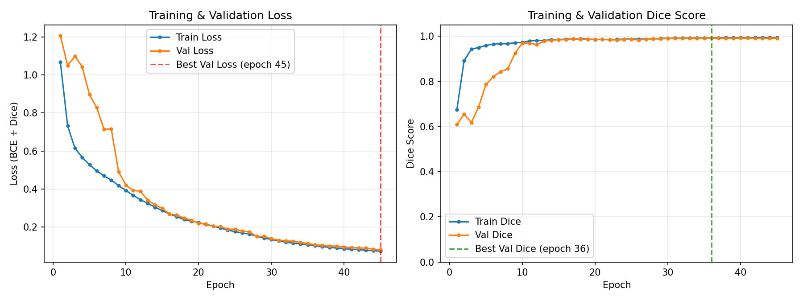
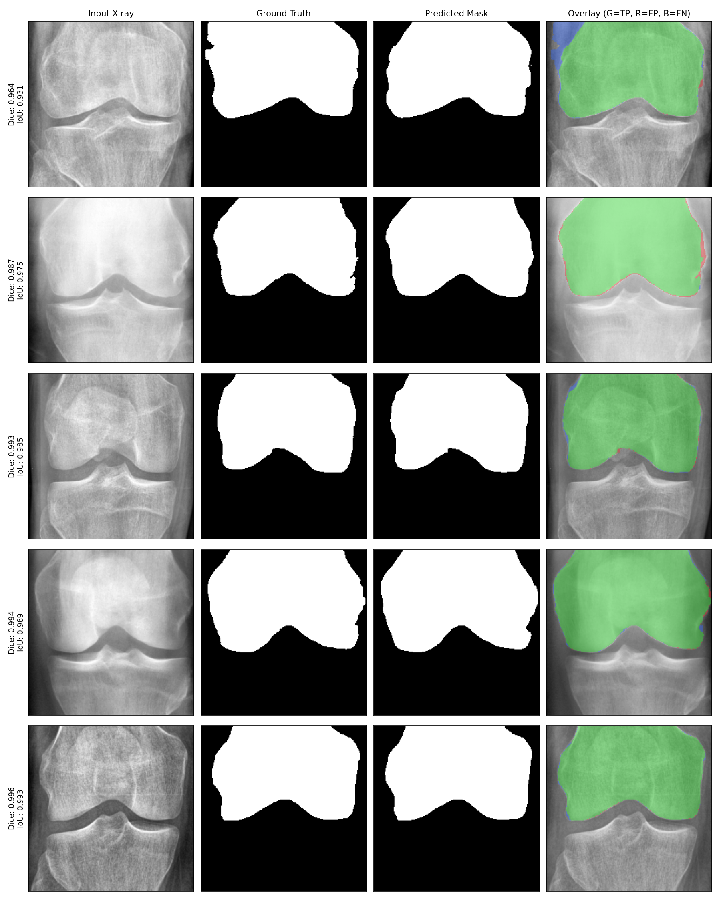

# Knee Femur X-Ray Segmentation

PyTorch U-Net pipeline for semantic segmentation of the distal femur in knee X-ray radiographs (`224 x 224` grayscale images).

## Dataset

Located in `data/`:
- `data/femur/` & `data/masks/`: **100** annotated X-ray / binary mask pairs (split into **80** training and **20** validation samples).
- `data/test_femur/`: **50** unannotated test X-rays for inference.
- `data/CSVs/`: Split index files (`train_dataset.csv`, `val_dataset.csv`, `test_dataset.csv`, `dataset.csv`) generated by `data_preparation.py`.

## Project Structure

- `data_preparation.py` — Builds train/val/test CSV splits and plots the split distribution.
- `datasets.py` — PyTorch `KneeDataset` loading grayscale X-rays and binary femur masks.
- `model.py` — Configurable `UNet` architecture (`depth=6`, base width `bw=24`, BatchNorm + ReLU, bilinear upsampling).
- `utils.py` — `dice_loss_from_logits` and `dice_score_from_logits`.
- `trainer.py` — Training and validation loop using `BCEWithLogitsLoss + Dice Loss` with Adam.
- `args.py` — CLI hyperparameters (`--epochs 45`, `--batch_size 16`, `--lr 1e-3`, `--weight_decay 1e-5`).
- `main.py` — Entry point for training.
- `evaluate.py` — Plots training curves, evaluates validation metrics (Loss, Dice, IoU, Pixel Accuracy), and runs test inference.

## Setup & Usage

```bash
pip install -r requirements.txt
```

1. **Train the model (default 45 epochs):**
   ```bash
   python main.py
   ```
   Saves trained weights (`sessions/model.pth`, git-ignored) and epoch metrics (`sessions/history.csv`).

2. **Evaluate and generate plots:**
   ```bash
   python evaluate.py
   ```
   Generates `training_curves.png`, `val_dice_distribution.png`, `val_predictions.png`, `test_predictions.png`, and predicted masks in `sessions/test_pred_masks/`.

## Results (45 Epochs)

Evaluated on the 20 held-out validation X-rays:

| Metric | Value |
| :--- | :--- |
| Validation Loss (BCE + Dice) | `0.0857` |
| Mean Dice Score | `0.9904 ± 0.0071` |
| Mean IoU | `0.9811 ± 0.0136` |
| Pixel Accuracy | `0.9917 ± 0.0062` |

### Training Curves


### Validation Predictions

